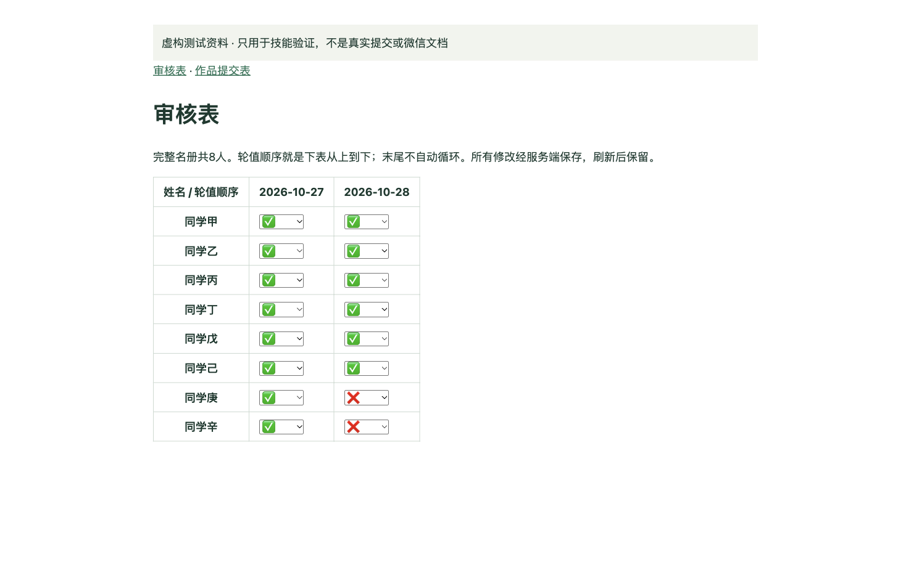

[简体中文](README.md) · [English](README.en.md)

# Daily Work Review Skill

Reusable instructions for checking submissions, reading original works, filling existing ✅/❌ table options, and producing a Chinese review report. **The review date is the target work date; never subtract a day.** The skill and report template are in Chinese.

## 1. Copy this installation request to your executor

```text
Install the Daily Work Review skill from
https://github.com/zaneliglhf-hash/daily-work-review-skill

Read INSTALL.md first. Download skills/daily-work-review with all its
referenced files and install it using this executor's supported method.
Check file integrity and whether the host recognizes the skill.
Check access to authenticated websites, original content, and table editing.
Report missing capabilities honestly. Show the three-field daily form.
Do not start a real review during installation.
```

**Verified in WorkBuddy 5.9.3: paste the instruction → download and verify → install and recognize → display the three-field form.** [Verification scope](docs/verification.md).

An executor needs network access and file/skill installation capabilities. Otherwise download the [Skill ZIP](dist/daily-work-review.zip) and import it through the host's skill manager. The ZIP does not include a model or browser.

## 2. Use it daily

```text
使用「每日作品审核」Skill。

审核链接：
审核日期：2026-10-28
本次审核人：

请核对提交情况、填写审核表，并生成完整审核汇报。
```

Provide the submission and audit table links in **审核链接** on first use. If only one is given, the agent looks for the other table's explicit link, then asks if it is missing. Group configuration may be saved in your own workspace for reuse. **审核日期** is the target date and report title date. **本次审核人** is the reviewer, not the author being reviewed. Tomorrow's reviewer is the next person in the source rotation; tomorrow's calendar date comes from the actual execution date.

All members are checked. By default, five distinct authors are reviewed in source order. Add `本次点评：@同学甲 @同学乙` to choose authors without narrowing attendance checks. Handle sign-in yourself when prompted, and copy the finished report to your group manually.

## Expected report

```text
10月28日审核同步

未完成人员名单；@姓名

作品1 @作者
这篇帖子的优点是……；缺点是……。

明日审核人：@姓名
审核情况：原审核表链接
```

This is a format illustration, not a real review. Execution status is reported separately. Missing content must not become invented feedback; incomplete submission evidence must not become ❌.

## Executed exercise



An independent executor checked eight synthetic members, read five full texts, and filled the existing options. Refresh preserved six ✅ and two ❌, with the previous day unchanged. [Actual generated sample report](examples/sample-report.txt), in Chinese. This simulated table does not prove compatibility with WeCom Docs.

## Compatibility and limits

A standard skill does not make every chat app capable of installing skills or controlling a browser. Browser-capable executors can attempt the full workflow. Material-only tools require the full roster, submissions and original text/images, and must state that online access and writeback were not performed.

[Installation](INSTALL.md) · [Compatibility](docs/compatibility.md) · [Verification](docs/verification.md) · [Synthetic exercise](examples/README.md) — these detailed documents are in Chinese.

Start with a test table. Quotas come from the host; this project has no built-in API and promises no unlimited free usage. Never commit private table links, credentials or real review records, including in public issues.
